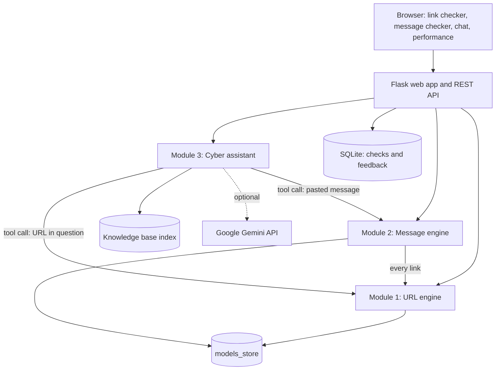

# Architecture

## One chatbot turn

1. **Guardrails** refuse requests to build attack tools or break into accounts.
2. Greetings are answered locally (no model call).
3. **Tools**: links in the question go to the URL engine; a pasted email or SMS goes to the message engine. Results become "tool results" and result cards in the UI.
4. **Retrieval**: the question (plus the previous question if it is very short) is matched against the knowledge-base chunks with TF-IDF cosine similarity; the top 3 passages are kept.
5. **Gemini** receives a system prompt, the recent chat history, the numbered passages, the tool results and the question. It is told to cite passages as [1], [2] and to treat all supplied text as data.
6. If Gemini is not configured or fails, an **offline answer** is built from the best passage and the tool results, with a notice explaining why.

## Why these choices

- **Standard-library Gemini client**: one HTTPS call, no SDK to break when versions change, easy to mock in tests.
- **TF-IDF retrieval**: no heavy models to download, runs on a free host, and is easy to explain in a viva. Embeddings are listed as future work.
- **Occlusion explanations**: removing one feature (or word) and measuring the change in probability explains any model without extra libraries.
- **Combined message score = max(text score, riskiest link score)**: a message is as dangerous as its most dangerous part, and the rule is simple to explain.
- **SQLite and standard-library rate limiting**: no external services, enough for a demo. For many users or several server processes use PostgreSQL and a shared limiter such as Redis.
